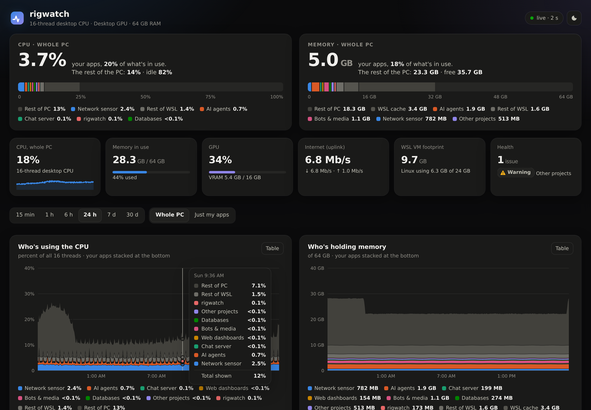
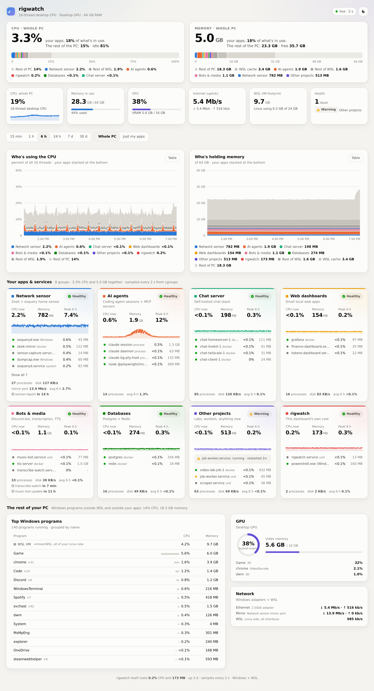
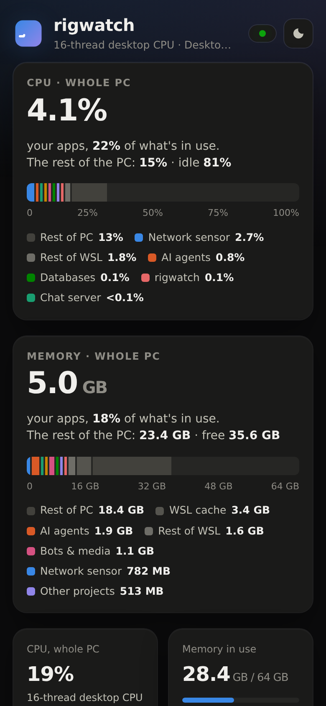

# rigwatch

**What do the things I self-host actually cost my PC?**

rigwatch is a live dashboard for a Windows + WSL2 machine that runs a pile of
home-grown services: systemd units, Docker stacks, AI coding agents, bots, sensors.
It splits the whole machine into *each of your apps*, *the rest of WSL*, *the rest of
Windows*, and *idle*, so the answer to "is my stuff the problem?" is one glance.



<sub>Screenshots are from `python3 -m rigwatch demo`, which uses made-up apps.</sub>

## What you get

- **Share of the whole PC.** CPU and memory bars that split 100% of the machine between
  your apps, the rest of WSL, WSL's page cache, the rest of Windows, and idle/free.
- **Timelines from 15 minutes to 30 days.** Stacked CPU and memory with your apps at the
  baseline, a crosshair tooltip (mouse or arrow keys), a "just my apps" zoom, and a
  table view of every chart.
- **One card per app.** CPU now, memory, peak and average for the range, a sparkline, and
  every unit, container, process and Windows program behind the app. Health covers failed
  or restarting units, unhealthy containers, *ghost* containers (Docker says "Up" but
  the processes are gone), and a watched Windows program that stopped. Cards also show
  when timers next run, disk throughput, and capture-port traffic.
- **The rest of your PC.** Top Windows programs, GPU (Task Manager's busiest-engine
  figure, VRAM, which program is using it), and every network adapter.
- **Light and dark**, phone-friendly, and no external scripts or fonts. The categorical
  palette is validated for colour-vision deficiency in both themes.

<p align="center">
  
  &nbsp;
  
</p>

## How it measures

Attribution is exact wherever the kernel already keeps the books.

| What | Where the numbers come from |
|---|---|
| systemd units and Docker containers | their cgroup v2: `cpu.stat`, `memory.current` minus page cache, `io.stat`, `pids.current` |
| Processes inside a shared cgroup (e.g. agent sessions in a terminal multiplexer) | `/proc/<pid>` CPU ticks and `RssAnon`, matched by command line and claimed with their whole process tree |
| WSL totals | `/proc/stat`, `/proc/meminfo`, `/proc/net/dev` |
| Windows | one long-lived PowerShell started over WSL interop ([`winsampler.ps1`](rigwatch/winsampler.ps1)): `GetSystemTimes`, `GlobalMemoryStatusEx`, per-process CPU deltas, GPU Engine counters, adapter statistics |

CPU is always a percent of the whole machine, on both sides, so the parts add up:

```
your apps + rest of WSL + rest of PC             = Windows CPU in use
your apps + rest of WSL + WSL cache + rest of PC = Windows memory in use
```

It samples every 2 s. The last 30 minutes stay in memory at full resolution, and one row
per series per minute goes to SQLite for 30 days. The server is stdlib-only Python
and streams snapshots to the page over Server-Sent Events. rigwatch measures its own
cost too: it's one of the cards.

## Try it

Any machine with Python 3.11+, no WSL needed:

```sh
git clone https://github.com/barnabys-drew/rigwatch && cd rigwatch
python3 -m rigwatch demo            # http://127.0.0.1:8775/
```

## Run it for real (Windows + WSL2 with systemd)

```sh
cp apps.example.toml apps.toml      # then point the groups at your own stuff
python3 -m rigwatch serve           # http://127.0.0.1:8775/
python3 -m rigwatch sample          # one snapshot as JSON, WSL side only
```

`deploy/up.sh` installs it as a systemd user service and, if Tailscale is installed on
Windows, publishes it to your tailnet with `tailscale serve`
(`RIGWATCH_TS_PORT`, default 10002; never Funnel, because the page lists every
program you run).

## Configure your apps

`apps.toml` maps things to at most eight groups. The order is the colour order:
colour follows the app, never its rank.

```toml
[[group]]
id = "sensor"
name = "Network sensor"
units = ["sensor-*.service"]          # systemd --user units
system_units = ["osqueryd.service"]   # system units
containers = ["zeek*"]                # docker container names
projects = ["sensor"]                 # docker compose projects
procs = ['\bsensor (run|ui)\b']       # command lines inside split_units
windows = ["dumpcap", "osqueryd"]     # Windows programs
nics = ["Mirror"]                     # a capture adapter's traffic
timers = ["sensor-*.timer"]           # timers shown on the card
```

One group can be `catch_all = true`. It picks up any user unit or container nobody
claimed, so a new project shows up without a config change. See
[`apps.example.toml`](apps.example.toml) for the full set.

## Tests

```sh
python3 -m unittest discover -s tests
```

## License

MIT
